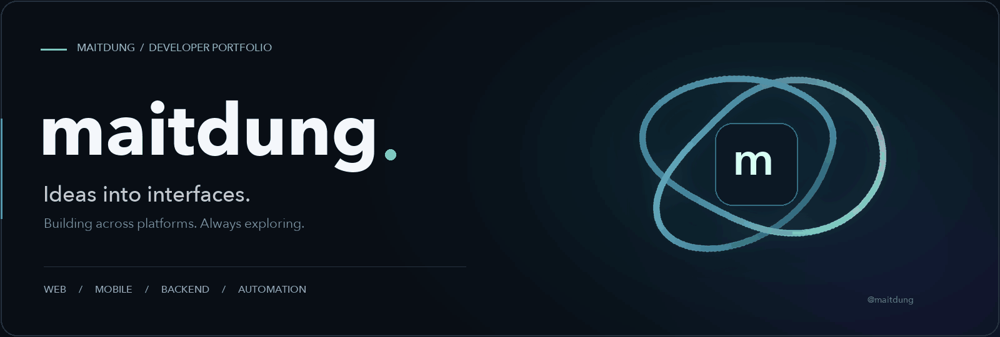

  

  <a href="#about">About</a> &nbsp;·&nbsp;
  <a href="#tech-stack">Tech Stack</a> &nbsp;·&nbsp;
  <a href="#github-insights">GitHub Insights</a> &nbsp;·&nbsp;
  <a href="#featured-projects">Projects</a> &nbsp;·&nbsp;
  <a href="https://github.com/maitdung?tab=repositories">Repositories ↗</a>

---

## About

### Hi, I'm @maitdung 👋

I build across web interfaces, mobile applications, backend APIs, and developer tooling. My public work brings together application development, Windows automation, and release workflows.

<table>
<tr>
<td width="33%" valign="top"><b>01 / Interfaces</b> Web experiences and mobile applications.</td>
<td width="33%" valign="top"><b>02 / Systems</b> Backend services and practical developer tools.</td>
<td width="33%" valign="top"><b>03 / Delivery</b> Automation, release workflows, and distribution.</td>
</tr>
</table>

## Tech stack

A broad technology toolbox across languages, platforms, and the development lifecycle.

#### Languages

  
  
  
  
  
  
  
  
  
  
  
  
  
  
  
  
  
  
  
  
  
  
  
  

#### Frontend & UI

  
  
  
  
  
  
  
  
  
  
  
  
  
  
  
  

#### Backend & APIs

  
  
  
  
  
  
  
  
  
  
  
  
  
  

#### Mobile & desktop

  
  
  
  
  
  
  
  

#### Databases & messaging

  
  
  
  
  
  
  
  
  
  
  

#### Cloud, DevOps & delivery

  
  
  
  
  
  
  
  
  
  
  
  
  
  
  

#### AI, data & machine learning

  
  
  
  
  
  
  
  
  
  

#### Testing, design & developer tools

  
  
  
  
  
  
  
  
  
  
  
  
  
  
  
  
  
  

## GitHub insights

Public activity and repository language distribution.

  

  
  

Stats are provided by GitHub Profile Summary Cards and may refresh with a delay. Language charts describe repositories, not skill levels.

## Featured projects

A selection of public work across platforms.

<table>
<tr>
<td width="50%" valign="top">
  01 · DEVELOPER TOOLS
  <h3><a href="https://github.com/maitdung/DiverWin">FreshWin / DiverWin</a></h3>
  
PowerShell tooling for Windows assessment, trusted application planning, and recovery workflows.

  
<b>PowerShell · Windows</b>

  <a href="https://github.com/maitdung/DiverWin">Explore project →</a>
</td>
<td width="50%" valign="top">
  02 · WEB APPLICATION
  <h3><a href="https://github.com/maitdung/English">MTD Lingo</a></h3>
  
A learning application using React, TypeScript, Tailwind CSS, and Vite.

  
<b>React · TypeScript</b>

  <a href="https://github.com/maitdung/English">Explore project →</a>
</td>
</tr>
<tr>
<td width="50%" valign="top">
  03 · BACKEND API
  <h3><a href="https://github.com/maitdung/vaultsec-backend-">VAULT.SEC</a></h3>
  
An Express backend integrating the VirusTotal API for file scanning.

  
<b>Node.js · Express</b>

  <a href="https://github.com/maitdung/vaultsec-backend-">Explore project →</a>
</td>
<td width="50%" valign="top">
  04 · RELEASE ENGINEERING
  <h3><a href="https://github.com/maitdung/PulsePlay-Releases">PulsePlay</a></h3>
  
App release assets, GitHub Actions workflows, and public update feeds.

  
<b>GitHub Actions · Distribution</b>

  <a href="https://github.com/maitdung/PulsePlay-Releases">Explore project →</a>
</td>
</tr>
<tr>
<td width="50%" valign="top">
  05 · MOBILE APPLICATION
  <h3><a href="https://github.com/maitdung/ClothingStore">ClothingStore</a></h3>
  
A Flutter clothing store project exploring mobile application development.

  
<b>Flutter · Dart</b>

  <a href="https://github.com/maitdung/ClothingStore">Explore project →</a>
</td>
<td width="50%" valign="top">
  06 · FRONTEND PRACTICE
  <h3><a href="https://github.com/maitdung/website-clone-angular">Angular Website</a></h3>
  
A website clone project built with Angular 19 and TypeScript.

  
<b>Angular · TypeScript</b>

  <a href="https://github.com/maitdung/website-clone-angular">Explore project →</a>
</td>
</tr>
</table>

---

  <b>Explore the work. Follow the progress.</b>  
  
  

