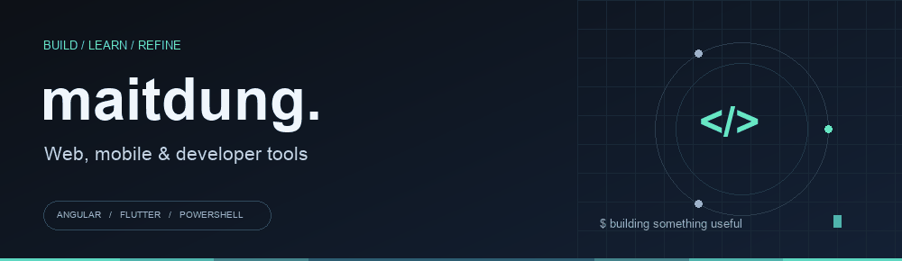

  

  <a href="#selected-work">Selected work</a> &nbsp;·&nbsp;
  <a href="#technology-stack">Tech stack</a> &nbsp;·&nbsp;
  <a href="#language--technology-radar">Language radar</a> &nbsp;·&nbsp;
  <a href="https://github.com/maitdung?tab=repositories">All repositories</a>

### Hi, I'm @maitdung

I build and explore projects across web interfaces, mobile apps, and developer tools. This profile brings together my public work, from Angular and Flutter projects to Windows tooling and app release automation.

### Selected work

| Project | What you'll find | Focus |
| :--- | :--- | :--- |
| **[FreshWin / DiverWin](https://github.com/maitdung/DiverWin)** | A PowerShell assistant for assessing Windows installations, planning changes, and managing trusted applications. | PowerShell · Windows tooling |
| **[PulsePlay Releases](https://github.com/maitdung/PulsePlay-Releases)** | Public app distribution, release workflows, and update feeds for PulsePlay. This repository contains release assets and tooling. | GitHub Actions · Release automation |
| **[MTD Lingo](https://github.com/maitdung/English)** | A learning app built with React, TypeScript, Tailwind CSS, and Vite. | React · TypeScript |
| **[VAULT.SEC Backend](https://github.com/maitdung/vaultsec-backend-)** | Express backend for file scanning through the VirusTotal API. | Node.js · Express |
| **[ClothingStore](https://github.com/maitdung/ClothingStore)** | A Flutter clothing store project. | Flutter · Dart |
| **[Angular Website](https://github.com/maitdung/website-clone-angular)** | A website clone project built with Angular 19. | Angular · TypeScript |

### Technology stack

Tools and languages represented in my public repositories.

**Languages & foundations**

  
  
  
  
  
  

**Frontend & UI**

  
  
  
  

**Mobile**

  
  

**Backend & delivery**

  
  
  
  
  

### What I build

| Area | Public project evidence |
| :--- | :--- |
| **Web interfaces** | Angular website projects and a React + TypeScript learning app. |
| **Mobile applications** | Flutter clothing store project. |
| **Backend APIs** | Express backend integrating the VirusTotal API for file scanning. |
| **Developer tooling** | PowerShell tooling for Windows assessment and application planning. |
| **Release automation** | GitHub Actions workflows and update feeds for PulsePlay releases. |

### Language & technology radar

<b>Explore the wider language landscape</b> · click to expand

 

A reference map of technologies to explore. Inclusion here does not indicate project experience or proficiency.

**General purpose & systems**

  
  
  
  
  
  
  
  

**Mobile & platform development**

  
  
  

**Web & scripting**

  
  
  
  
  

**Functional & concurrent**

  
  
  
  
  
  
  

**Data & scientific computing**

  
  
  
  
  

**Specialized languages**

  
  
  
  
  
  

**Databases & infrastructure to explore**

  
  
  
  
  
  
  
  

---

  Explore the repositories for source code, documentation, and project updates.

